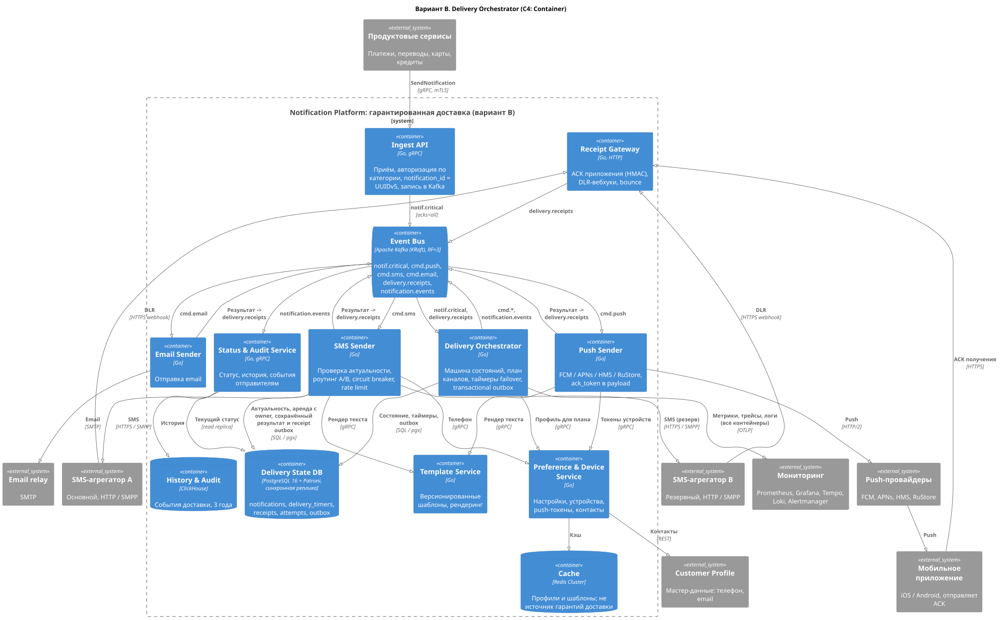

# Notification Platform

Централизованная платформа уведомлений онлайн-банка. Проект содержит архитектурное решение и исполняемый прототип доставки критичных уведомлений с переключением `push → SMS → email`.

**Для защиты:** локальный HTTP API со Swagger UI, виртуальными часами, имитаторами провайдеров и журналом событий. Требуется только **Go 1.24+**. Kafka, PostgreSQL, Docker, аккаунты провайдеров и интернет для запуска не нужны.

## Быстрый запуск

Из корня проекта:

```bash
make run
```

Или без Make:

```bash
cd code
go run -buildvcs=false ./cmd/demo
```

Откройте **[http://127.0.0.1:8080/swagger/](http://127.0.0.1:8080/swagger/)**. Остановить сервер — `Ctrl+C`.

Другой порт:

```bash
cd code
go run -buildvcs=false ./cmd/demo -addr 127.0.0.1:8090
```

Swagger встроен в бинарник вместе с JS/CSS и OpenAPI. Внешних CDN нет. По умолчанию сервер доступен только на локальном компьютере.

## Показ за 5–7 минут

1. В Swagger выполните `DELETE /api/demo`, чтобы очистить стенд.
2. Откройте `POST /api/demo/scenarios/{name}`, нажмите **Try it out**, выберите `failover`, затем **Execute**.
3. В ответе покажите `notification.state = DELIVERED`, `delivered_via = sms`, план каналов и события: push принят → 10 секунд без ACK → SMS → агрегатор A отказал → агрегатор B принял → пришёл DLR.
4. Запустите `late-ack`: появится `cross_channel_duplicate`. Объясните, почему поздний ACK может подтвердить доставку по двум каналам.
5. Запустите `retry`: временно недоступны контакты, затем публикация receipt. Несмотря на два повтора, в `provider_submissions` будет **одна SMS**.
6. Запустите `expired` и `all-failed`: покажите различие `EXPIRED` и `FAILED`.
7. Откройте [метрики](http://127.0.0.1:8080/metrics) и объясните выбор оркестратора по [RFC](docs/RFC.md).

В `provider_submissions` считаются **принятые имитатором отправки**, а не число команд/HTTP-вызовов. Отказ A отражается событием `provider_rejected`.

| Сценарий | Что демонстрирует | Результат |
| --- | --- | --- |
| `push-success` | ACK push, резерв не нужен | `DELIVERED / push` |
| `failover` | Таймаут push, отказ SMS A, успех B | `DELIVERED / sms` |
| `late-ack` | Позднее подтверждение push после SMS | `DELIVERED / sms` + событие дубля |
| `retry` | Сбои контактов и публикации результата | `DELIVERED / sms`, одна отправка |
| `expired` | TTL меньше таймаута push | `EXPIRED`, SMS не отправлена |
| `all-failed` | Постоянный отказ всех каналов | `FAILED` |
| `email-only` | Провайдер принял email, ACK отсутствует | `SENT`, доставка не подтверждена |

Время **виртуальное и общее для стенда**: ожидание в браузере ничего не меняет. Готовые сценарии сами продвигают часы; ручное управление — `POST /api/demo/advance`. Реальные push/SMS/email не отправляются. Данные теряются при перезапуске.

Подробный ручной показ, команды curl и ответы на вопросы: [DEMO.md](docs/DEMO.md).

## Что реализовано

- Ядро на Go: план каналов с учётом предпочтений, машина состояний, дедупликация приёма, транзакционная запись команд/событий и таймеров.
- Таймауты: push — 10 с, SECURITY push — 5 с, SMS DLR — 60 с; таймер ограничен TTL.
- Проверка receipts: канал должен соответствовать запущенному шагу; повторные подтверждения не создают новые события.
- SMS Sender: аренда попытки с владельцем, повтор после предварительной ошибки, сохранение результата перед публикацией, восстановление после сбоя публикации.
- Неоднозначный ответ провайдера вызывает повтор/сверку исхода, а не немедленный переход к другому агрегатору.
- HTTP API, OpenAPI 3.0.3, автономный Swagger UI, сценарии ошибок, метрики Prometheus.
- Транзакционный адаптер **в памяти**, имитация очереди/outbox и провайдеров. Исполняется то же ядро, которое проверяют unit-тесты.

Целевая архитектура использует **Kafka + PostgreSQL + Redis-кэш + ClickHouse**. Подключения к ним, реальные шлюзы, HMAC ACK, mTLS, полноценные circuit breaker/rate limiter и промышленное развёртывание описаны в RFC, но **не реализованы в локальном прототипе**. Производительность и SLO ниже — проектные цели, не результаты нагрузочного теста.

## 1. Функциональные требования

| ID | Поведение системы | Бизнес-цель |
| --- | --- | --- |
| FR-1 | Принимать уведомления от всех продуктовых команд через единый интерфейс | Централизованный контроль |
| FR-2 | Различать транзакционные, уведомления безопасности и маркетинговые сообщения | Правила доставки по важности |
| FR-3 | Доставлять через push, SMS и email с учётом доступных контактов | Доступность уведомлений клиенту |
| FR-4 | Автоматически использовать резервный канал при отказе или отсутствии подтверждения | Снизить число пропущенных критичных сообщений |
| FR-5 | Учитывать предпочтительный канал; разрешать отключение маркетинга, но не критичных категорий | Контроль клиента без потери обязательного информирования |
| FR-6 | Повтор одного бизнес-события не должен создавать новое уведомление | Снизить дубли и обращения в поддержку |
| FR-7 | Показывать отправителю и поддержке текущий статус и историю доставки | Разбор проблем и аудит |
| FR-8 | Поддерживать утверждённые шаблоны и локализацию сообщения | Единообразие и корректность текста |
| FR-9 | Прекращать новые отправки после срока актуальности и сообщать о неудаче | Не отправлять устаревшие сообщения |
| FR-10 | Обслуживать критичные уведомления независимо от маркетинговых рассылок | Сохранять качество важных сценариев |

Маркетинг, управление шаблонами и настройками — требования **ко всей платформе**. Исполняемый прототип ограничен `TRANSACTIONAL` и `SECURITY`; выбор профиля в запросе заменяет Preference Service.

## 2. Нефункциональные требования

Все численные показатели — **допущения для проектирования**, которые нужно согласовать с бизнесом и проверить экспериментально.

| ID | Измеримое требование | Как проверять |
| --- | --- | --- |
| NFR-1 | Приём: 6 000 уведомлений/с длительно, всплеск 12 000/с в течение 60 с; p99 ответа ≤ 250 мс | Нагрузочное испытание с записью в настоящий брокер |
| NFR-2 | При доступном допустимом канале и согласованных квотах ≥ 99,9% критичных уведомлений подтверждены за 90 с от приёма | ACK/DLR и распределение end-to-end latency; `SENT` не считается успехом |
| NFR-3 | Доступность приёма ≥ 99,95% за месяц; отказ одного экземпляра/узла не останавливает обработку | SLI доступности и fault injection |
| NFR-4 | RPO=0 для подтверждённого приёма при отказе одного узла в основном кластере; восстановление работы ≤ 60 с | Отключение брокера/primary, сверка ID |
| NFR-5 | Один ключ приёма и один логический шаг не порождают новую логическую операцию при replay в пределах 72 ч | Повтор запросов и сообщений, проверки уникальности |
| NFR-6 | Все переходы состояния имеют ID и время события; статус после принятого receipt обновляется за p99 ≤ 2 с | Проверка трассировки и consumer lag |
| NFR-7 | 100% внешних соединений production защищены TLS; неавторизованные ACK и запросы отклоняются; секреты и полные контакты отсутствуют в логах | Негативные security-тесты и проверка логов |
| NFR-8 | При восстановлении кластера после потери площадки RPO ≤ 1 мин, RTO ≤ 30 мин | Отдельное DR-учение; это более слабая гарантия, чем отказ одного узла |
| NFR-9 | Добавление канала требует одного адаптера и конфигурации политики без изменения продуктовых отправителей | Архитектурная проверка интеграции нового канала |

NFR-2 условен: если все устройства/контакты/провайдеры недоступны, физическую доставку обещать нельзя. Для всех принятых сообщений дополнительно считаем безусловный delivery rate и причины неуспеха, не скрывая провайдерские отказы исключениями из отчёта.

## 3. Архитектурно значимые требования (ASR)

| ASR | Источник | Почему значим | Архитектурные последствия |
| --- | --- | --- | --- |
| ASR-1: сохранность принятых задач | FR-1, NFR-3/4 | Потеря сообщения о списании подрывает доверие | Устойчивый брокер, синхронная репликация состояния, outbox, повторная обработка |
| ASR-2: срок доставки и изоляция критичных | FR-4/9/10, NFR-2 | Важное сообщение должно прийти пока актуально | Отдельные очереди/ресурсы критичных, постоянные таймеры, TTL, квоты |
| ASR-3: идемпотентность и корректный failover | FR-6, NFR-5 | Повторы приводят к лишним SMS и обращениям | Уникальные ID, сериализация состояния, журнал попыток, дедуп receipts, явная политика UNKNOWN |
| ASR-4: рост и пики нагрузки | NFR-1 | Массовые операции и отказ push создают всплески | Партиционирование, горизонтальные workers, backpressure, capacity planning |
| ASR-5: предпочтения и стоимость | FR-3/5, NFR-9 | SMS дороже push; каналы доступны не всем | Политика маршрутизации, кэш профилей, адаптеры каналов, бюджеты и rate limits |
| ASR-6: наблюдаемость и защита данных | FR-7, NFR-6/7 | Нужны доказуемый статус и безопасный разбор инцидентов | Аудит, correlation ID, метрики, проверка ACK/DLR, разграничение доступа |

## 4. Приоритеты и сценарии качества

Приоритеты: **сохранность → срок критичной доставки → уменьшение дублей → стоимость**. При неизвестном исходе приоритет доставки допускает остаточный риск межканального дубля; это фиксируется в аудите.

- **Отказ worker после фиксации состояния:** команда остаётся в outbox, публикация возобновляется, результат не теряется.
- **Нет ACK push:** через 10 с запускается следующий доступный канал; подтверждение до истечения таймера отменяет дальнейшую обработку.
- **Маркетинговый всплеск:** критичные очереди и квоты сохраняют выделенную пропускную способность.
- **Потерян ответ SMS:** повтор проверяет исход у того же агрегатора с тем же ID; подтверждённый отказ разрешает переключение на B.

Пункт 4 исходного задания и связанный шаблон RFC на переданных скриншотах отсутствуют. Этот раздел — дополнительное обоснование; соответствие неизвестному пункту не утверждается.

## 5. Архитектурные последствия ASR

Таблица выше задаёт последствия каждого ASR. Подробное сравнение двух решений и проверка **каждого ASR для обоих вариантов** — в [RFC, разделах 6–8](docs/RFC.md#6-вариант-a-хореография-на-kafka).

Выбран **вариант B: оркестратор доставки**. PostgreSQL хранит план и состояние; Kafka переносит задачи и результаты; отправители не определяют общий жизненный цикл сообщения. Redis используется как кэш, а не как единственный источник гарантий.



[PlantUML](diagrams/rfc-b-c4-container.puml) · [Вариант A](diagrams/rfc-a-c4-container.puml) · [Контекст](diagrams/rfc-c4-context.puml) · [Все диаграммы](diagrams/)

## 6. Решения, которые не подходят

| Решение | Нарушаемые ASR | Причина |
| --- | --- | --- |
| Синхронно вызвать провайдера внутри обработки платежа | ASR-1/2/4 | Зависимость времени и доступности платежа от внешнего провайдера; нет устойчивого восстановления попытки |
| Одна FIFO-очередь для критичных и маркетинга с общей квотой | ASR-2/4 | Массовая рассылка задерживает сообщения о списании |
| Redis `SETNX` как единственное доказательство завершённой отправки | ASR-1/3 | Сбой между установкой флага и внешним действием подавляет нужный повтор; потеря флага допускает лишнюю отправку |
| Сразу отправлять во все каналы | ASR-3/5 | Стоимость SMS и межканальные дубли возникают даже при успешном push |

## 7. Неопределённости и риски

| Что неизвестно | Риск | Как проверить / снизить |
| --- | --- | --- |
| Продолжение исходного условия с количеством уведомлений на пользователя | Неверный расчёт RPS, хранения и квот | Уточнить условие; до этого использовать явно помеченную модель нагрузки из RFC |
| Реальная доля push ACK и задержка DLR | Ошибочный таймаут и лишние SMS | Пилот на реальных устройствах, распределения ACK/DLR по ОС и провайдеру |
| Срок/область идемпотентности агрегаторов, API сверки статуса | Повторная SMS после неизвестного исхода | Контрактные тесты, закрепление провайдера за попыткой, сверка по ClientMsgID |
| Пропускная способность PostgreSQL-таймеров и outbox | Рост задержки и дедлоки | Нагрузка на настоящей БД, единый порядок блокировок, обработка deadlock/serialization retry |
| Квоты SMS при массовом отказе push | Невыполнение delivery SLO | Согласовать аварийную квоту с двумя агрегаторами; отдельные лимиты критичных |
| Требуемый срок аудита и хранения персональных данных | Избыточное или недостаточное хранение | Согласовать с владельцами данных; срок 3 года в архитектуре пока является допущением |

## 8. RFC

[Полный RFC: гарантированная обработка и доставка критичных уведомлений](docs/RFC.md) содержит контекст, цели, нагрузку, границы гарантий, два варианта с C4/Sequence PlantUML, соответствие ASR, выбор решения, модель данных, сбои, безопасность, наблюдаемость, стоимость, rollout и план проверки.

## Проверка и сборка

```bash
make test       # все Go-тесты
make race       # те же тесты с race detector, нужен CGO/компилятор C
make vet
make build      # bin/notification-demo
./bin/notification-demo
```

Без Make:

```bash
cd code
go test ./...
go test -race ./...
go vet ./...
go build -buildvcs=false -o ../bin/notification-demo ./cmd/demo
```

Проверяются повторный приём, конкурентный приём, гонка ACK/таймера, TTL, некорректные receipts, rollback, аренды попыток, восстановление публикации, неоднозначный ответ SMS, ручной HTTP-поток и все семь сценариев защиты. Тесты в памяти **не доказывают** надёжность настоящих PostgreSQL/Kafka/провайдеров.

Для пересборки SVG установите Java и PlantUML, затем:

```bash
PLANTUML_JAR=/path/to/plantuml.jar make diagrams
```

Готовые SVG уже лежат в `diagrams/rendered`, для просмотра Java не нужна.

## Структура

```text
README.md                       требования, ASR и запуск
Makefile                        запуск, тесты, сборка, диаграммы
docs/RFC.md                     архитектурный документ
docs/DEMO.md                    сценарий защиты и ручные запросы
diagrams/*.puml                 исходники C4, sequence, state machine
diagrams/rendered/*.svg         готовые изображения
code/delivery/                  ядро и транзакционные demo-адаптеры
code/internal/demo/             HTTP API, имитаторы и виртуальные часы
code/internal/demo/assets/      OpenAPI и локальный Swagger UI
code/cmd/demo/                  точка входа
scripts/                        проверка HTTP и рендер диаграмм
```

Спецификация: [openapi.json](code/internal/demo/assets/openapi.json). Swagger UI vendored из [официального дистрибутива v5.17.14](https://github.com/swagger-api/swagger-ui/tree/v5.17.14/dist), лицензия Apache-2.0 находится рядом с файлами. Формат API — [OpenAPI 3.0.3](https://spec.openapis.org/oas/v3.0.3).
