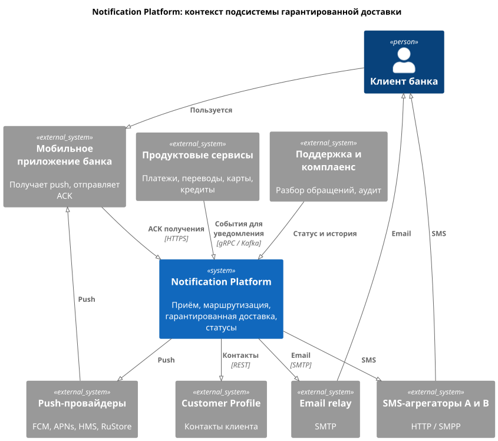
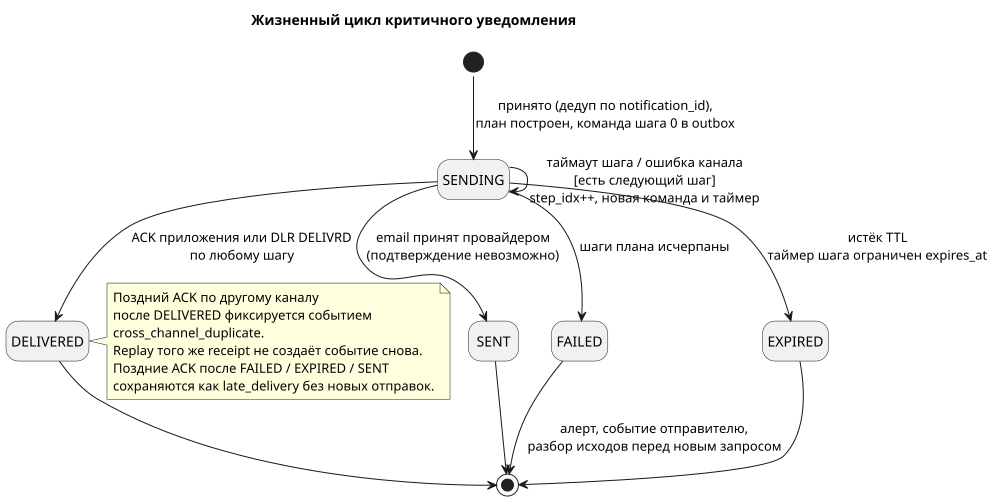
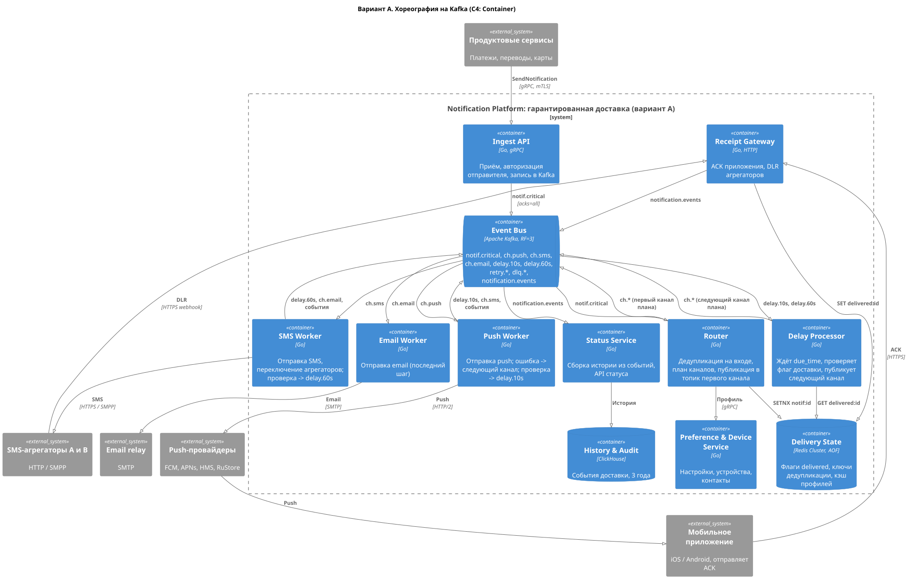
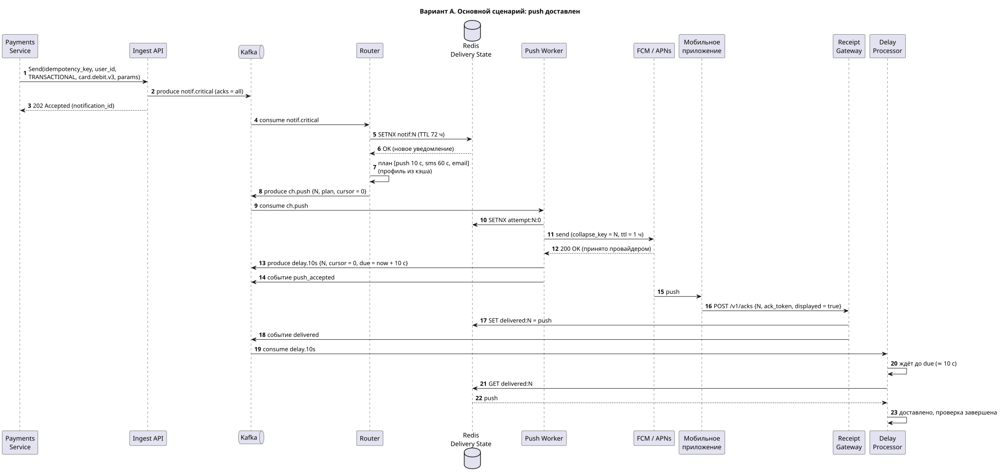
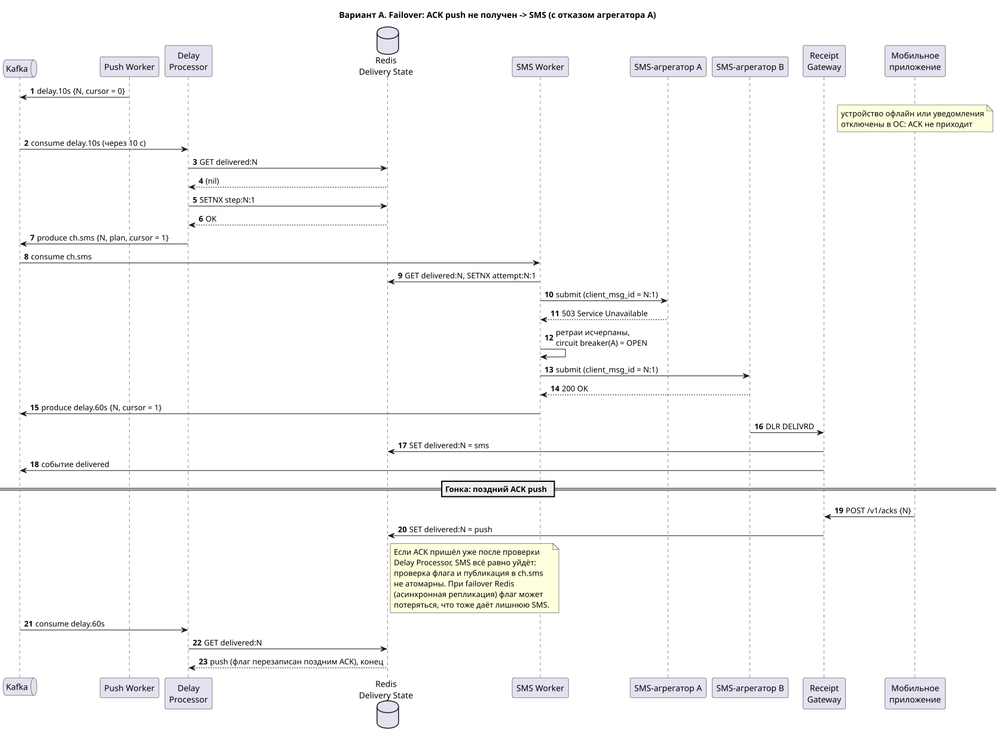
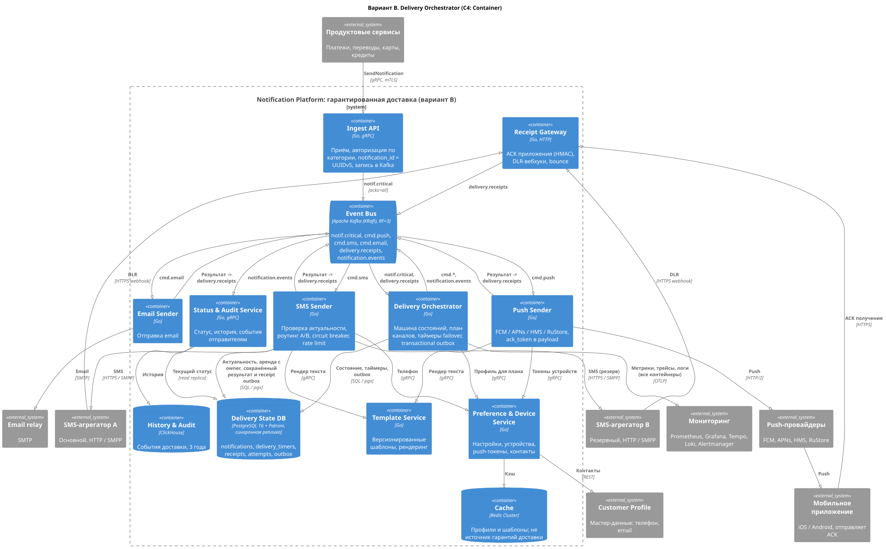
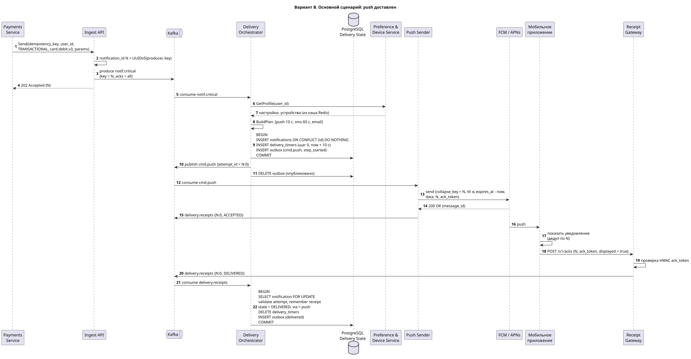
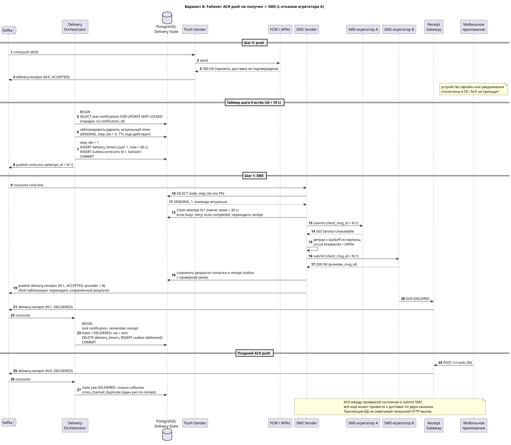

# RFC-001. Доставка критичных уведомлений с переключением каналов

| Поле | Значение |
| --- | --- |
| Статус | Предложение; исполняемый локальный прототип варианта B |
| Дата | 17 ноября 2026 |
| Область | Подсистема TRANSACTIONAL / SECURITY в Notification Platform |
| Решение | Централизованный оркестратор + постоянное состояние + асинхронные отправители |
| Связанные материалы | [Требования и ASR](../README.md), [сценарий демонстрации](DEMO.md) |

Оригинальный шаблон, на который ссылается задание, не приложен. Использована стандартная структура RFC: контекст, цели, ограничения, альтернативы, решение, последствия, проверка и открытые вопросы. Численные требования, отсутствующие на скриншотах, явно приняты как допущения.

## 1. Контекст и проблема

Платежи, переводы, оформление продуктов и маркетинг независимо отправляют уведомления. Возникают задержки, дубли, неодинаковые статусы и отсутствие единого контроля. Уведомления о списании, переводе и безопасности особенно чувствительны к недоставке.

Провайдеры push, SMS и email имеют разную стоимость и доступность. Принятие сообщения push-провайдером не доказывает получение устройством. Отсутствие ACK не доказывает отсутствие доставки: мог потеряться сам ACK. Необходима единая модель принятия, подтверждений и переключения, устойчивая к повторам и сбоям.

[Исходник C4 Context](../diagrams/rfc-c4-context.puml).

## 2. Цели и границы

Цели:

- Сохранять подтверждённые запросы и возобновлять незавершённую обработку после отказа компонента.
- Автоматически выбирать доступные каналы и переходить к резерву по постоянной ошибке или таймауту подтверждения.
- Уменьшать дубли повторной обработки и расходы на SMS.
- Давать отправителю доказуемую историю, различая принятие провайдером и подтверждение доставки.
- Изолировать критичные сообщения от маркетинговой нагрузки.

Вне области этого RFC: выполнение банковских операций, полный конструктор рассылок, доставляемость email-кампаний, пользовательский inbox, содержание банковских правил согласий. Проверки подписи ACK и авторизации описаны как необходимые части production, но локальный стенд их не реализует.

Требования ко всей платформе определены как FR-1…FR-10, NFR-1…NFR-9 и ASR-1…ASR-6 в README. Здесь они уточняются для критичной доставки. Маркетинговое отключение не влияет на `TRANSACTIONAL` и `SECURITY`; это принятое продуктовое правило, которое должен подтвердить владелец продукта.

## 3. Семантика «гарантированной доставки»

Гарантия состоит из трёх разных уровней:

1. **Принятие:** ответ об успехе выдаётся после устойчивой фиксации задачи. Потерянный ответ клиент повторяет с тем же ключом.
2. **Обработка:** at-least-once потребление, сохранённые состояния/таймеры и идемпотентные эффекты внутри платформы. После исчерпания плана сообщение получает объяснимый конечный исход.
3. **Внешняя доставка:** подтверждается ACK приложения для push или DLR оператора для SMS. DLR подтверждает доставку согласно контракту оператора, а не прочтение человеком.

Гарантия получения хотя бы по одному каналу **условна**: должен существовать доступный разрешённый канал с действительным контактом, достаточной квотой и временем до TTL. Если все провайдеры недоступны, устройство офлайн, а номер не обслуживается, абсолютная физическая доставка недостижима. `FAILED`, `EXPIRED` и неподтверждённый `SENT` не выдаются за успешную доставку.

Идемпотентность одного шага не равна отсутствию дублей между каналами. После истечения push ACK timeout SMS может быть отправлена, хотя push был показан, но ACK задержался. Детерминированные ID устраняют логические повторы внутри канала при поддержке идемпотентности провайдером; транзакция PostgreSQL не охватывает внешний HTTP/SMPP и не может атомарно отменить уже отправленную SMS.

Выбранная политика предпочитает шанс своевременной доставки небольшому риску межканального дубля. Риск измеряется. Повторный ACK того же шага не считается новым дублем. Отсутствие ACK нельзя использовать как основание утверждать, что дублей нет.

## 4. Масштаб, нагрузка и стоимость

Дано условием: **MAU 10 млн**, **DAU 3 млн**, **300 тыс. одновременных пользователей**. Продолжение условия с частотой уведомлений отсутствует.

Принята модель: 6 критичных и 2 маркетинговых сообщения на DAU в сутки, коэффициент пика 20. Это расчётное допущение, а не наблюдение.

| Показатель | Расчёт | Значение |
| --- | --- | --- |
| Все уведомления/сутки | 3 млн × 8 | 24 млн |
| Критичные/сутки | 3 млн × 6 | 18 млн |
| Средний общий поток | 24 млн / 86 400 | ≈ 278/с |
| Средний критичный поток | 18 млн / 86 400 | ≈ 208/с |
| Пиковый общий поток | 278 × 20 | ≈ 5 556/с |
| Пиковый критичный поток | 208 × 20 | ≈ 4 167/с |
| Цель приёма с запасом | округление | 6 000/с; burst 12 000/с на 60 с |
| События критичных, грубая верхняя оценка штатного пика | 4 167 × 10 событий | ≈ 41 670/с |
| SMS в аварии push | до одной SMS на критичное | ≈ 4 167/с до исчерпания квот |

Concurrent Users не переводятся напрямую в RPS: частота событий на активного пользователя неизвестна. Коэффициент 20 нужно заменить измеренным распределением.

Начальная гипотеза Kafka: 48 партиций для критичного входа и 48 для receipts; команды каналов — по фактической доле нагрузки. При burst 12 тыс./с получается 250 входных сообщений/с на партицию. Это не доказательство пропускной способности: размер сообщения, стоимость транзакций и skew по ключам проверяются нагрузочным тестом. Ключ сообщений оркестратора — `notification_id`; записи разных топиков всё равно могут приходить в разном порядке, поэтому корректность обеспечивается БД, а не порядком Kafka между топиками.

Оценка хранения критичных:

- Оперативная запись с индексами: условно 3 КБ × 18 млн = **54 ГБ/сутки**, 7 суток — **378 ГБ** на primary до запаса, WAL и реплик. Две полные реплики увеличивают базовую сумму примерно втрое.
- Аудит: 6 событий × 400 байт × 18 млн = **43,2 ГБ/сутки**, за 1 095 дней — около **47,3 ТБ** до сжатия и репликации. Retention 3 года — допущение, требующее согласования.
- Attempts, receipts, outbox и индексы оцениваются отдельно по реальным схемам; приведённые 378 ГБ не являются полной оценкой кластера.
- В Kafka события и команды хранятся 72 ч; состояние дедупликации и результатов попыток — не менее 7 суток. Политика replay не должна выходить за окно сохранённых ключей без процедуры сверки.

Начинать можно с одного HA PostgreSQL-кластера и ограниченного количества workers. Переход к нескольким шардам по `hash(notification_id)` возможен после измерения БД; количество шардов не назначается без теста.

Стоимость выражаем через `Cpush`, `Csms`, `Cemail`:

`C = Npush × Cpush + Nsms × Csms + Nemail × Cemail`.

При условном fallback 5% от 18 млн критичных получится 900 тыс. SMS/сутки. При массовом отказе push — до 18 млн. Это оценка чувствительности бюджета; тарифы и фактическая доля предпочтительного SMS неизвестны. Сокращать расходы можно актуальными push-токенами, исправным ACK, адаптацией таймаутов по измерениям и кэшированием профилей. Жёсткий маркетинговый бюджет не должен молча блокировать критичные сообщения.

## 5. Политики каналов и состояния

План фиксируется при принятии задачи:

- По умолчанию `push → SMS → email`, недоступные каналы исключаются.
- Push пригоден при активном токене, поддержке ACK и отсутствии признака последних трёх неподтверждённых отправок.
- Если клиент предпочёл SMS и есть телефон: `SMS → push → email`.
- Для `TRANSACTIONAL` push ACK timeout 10 с; для `SECURITY` 5 с. SMS DLR timeout 60 с. Ошибка постоянного характера немедленно переводит план дальше.
- Email — последний резерв, принятие даёт `SENT`, но не `DELIVERED`. В локальном демо email не поддерживает подтверждения.
- Все таймауты включают время ожидания команды и вызова провайдера. Поэтому sender перед внешним вызовом проверяет актуальность шага.
- Общий TTL по умолчанию в демо 1 ч; production-политика допускает до 24 ч в зависимости от шаблона/категории. Дедлайн таймера — `min(время запуска + timeout, expires_at)`.
- Критичные категории нельзя отключить целиком. Предпочтение влияет на порядок, а не отменяет резерв. При отсутствии всех контактов результат — `FAILED/no_available_channels`.

Контакты получаются при отправке из доверенного Profile Service. При изменении контакта/привязки устройств требуется проверка актуальности и принадлежности получателя; полный номер не хранится в открытом event payload.

[PlantUML состояния](../diagrams/rfc-state-machine.puml).

Терминальные состояния завершают **принятие решений об отправке**. Поздний подтверждённый результат после `FAILED`, `EXPIRED` или `SENT` сохраняется событием `late_delivery`; новые отправки не запускаются. После `DELIVERED` подтверждение другого канала создаёт `cross_channel_duplicate`. В поддержке следует показывать конечный исход обработки вместе с доказательствами поздней доставки; нельзя интерпретировать один `FAILED` без истории как отсутствие физической доставки.

## 6. Вариант A: хореография на Kafka

### Архитектура

Go Ingest публикует событие в Kafka. Router строит план, channel workers отправляют сообщения и публикуют следующую команду. Delay Processor обрабатывает задания с `due_time`; Redis Cluster хранит флаги доставки и дедупликации. События истории поступают через Status Service в ClickHouse.

Технологии: Go, Apache Kafka с RF=3, Redis Cluster с AOF, ClickHouse, gRPC/HTTPS, FCM/APNs/HMS/RuStore и два SMS-агрегатора.

[PlantUML C4 Container](../diagrams/rfc-a-c4-container.puml).

### Основной сценарий

[PlantUML Sequence](../diagrams/rfc-a-seq-main.puml).

### Failover

[PlantUML Sequence failover](../diagrams/rfc-a-seq-failover.puml).

### Последствия

Плюсы: независимое масштабирование каналов, мало централизованной бизнес-логики, естественный асинхронный поток.

Недостатки:

- `SETNX notif` и публикация команды Kafka не атомарны. Сбой после установки флага может подавить повтор до отправки. Kafka-транзакция сама по себе не включает Redis.
- Аналогичная проблема существует между `SETNX attempt` и внешним вызовом. Нужен журнал с результатом и восстановлением, а не только boolean-флаг.
- Таймер после send не защищает от падения worker до публикации самого таймера. Требуются устойчивое планирование и восстановление.
- Потеря Redis-флага при failover либо гонка проверки и отправки дают дополнительные SMS.
- Delay Processor не должен просто спать на одном сообщении, блокируя партицию. Потребуется отдельный устойчивый индекс due-time либо stream-processing state store.
- Общий статус реконструируется из событий, их порядок и дубли нужно учитывать во всех обработчиках.

В изложенном виде вариант A не удовлетворяет строгим ASR-1 и ASR-3. Его можно усилить, но постоянные журналы, таймеры и правила координации фактически приближают его к варианту B.

## 7. Вариант B: Delivery Orchestrator

### Архитектура

Go Orchestrator владеет планом и переходами состояния. PostgreSQL хранит notification, timers, receipt inbox, журнал attempts и outbox. Kafka доставляет вход, команды и receipts. Отправители каналов не выбирают следующий канал: они возвращают результат попытки. Redis хранит только восстанавливаемый кэш профилей/шаблонов.

Технологии:

- Go 1.24+; HTTP для демонстрации, gRPC/mTLS для внутреннего production API.
- Apache Kafka в KRaft-режиме, RF=3, `acks=all`, `min.insync.replicas=2`, отключённый unclean leader election; producer idempotence. Параметры должны обеспечиваться также конфигурацией топиков, а не только клиента.
- PostgreSQL 16, Patroni, синхронная реплика; подтверждённый commit должен переживать отказ одного узла. Фактический HA/fencing и настройка синхронной фиксации проверяются учением.
- pgx для будущего SQL-адаптера; Redis Cluster для кэшей; ClickHouse для аудита.
- Prometheus/Grafana, OpenTelemetry/Tempo, Loki/Alertmanager как целевой стек наблюдаемости.

[PlantUML C4 Container](../diagrams/rfc-b-c4-container.puml).

### Основной сценарий

[PlantUML Sequence](../diagrams/rfc-b-seq-main.puml).

### Failover

[PlantUML Sequence failover](../diagrams/rfc-b-seq-failover.puml).

Новый вариант диаграммы сохраняет результат попытки в PostgreSQL, а не в Redis. Отдельная публикация receipt из outbox production позволяет восстановиться независимо от повтора исходной команды. В локальном прототипе сохранённый результат переиздаётся при повторе команды из имитатора очереди.

## 8. Соответствие ASR и выбор

| ASR | Вариант A | Вариант B |
| --- | --- | --- |
| ASR-1: сохранность | Kafka хранит вход, но dual-write Redis/Kafka и окно send/timer оставляют потерю продолжения; нужны дополнительные механизмы | State + timer + command/event outbox в одной транзакции, consumer ACK после commit, результат sender сохраняется |
| ASR-2: срок/изоляция | Отдельные топики возможны; due-time требует устойчивой реализации; падение до публикации таймера опасно | Постоянные таймеры, TTL, отдельные critical topics, выделенные ресурсы и лимиты |
| ASR-3: идемпотентность/failover | SETNX уменьшает дубли, но не отличает занятую попытку от завершённой; логика распределена | Уникальные notification/attempt, owner leases, receipt inbox, сериализация переходов; остаточный межканальный дубль явно допускается |
| ASR-4: масштаб | Workers масштабируются по партициям; горячий Redis и delay scheduling требуют проверки | Workers масштабируются; PostgreSQL становится местом проверки capacity; предусмотрено шардирование по ID |
| ASR-5: стоимость/настройки | Router строит план, но таймауты и бюджет распределены между workers | Версионированная политика, сохранённый план, централизованная аналитика fallback; кэш профилей |
| ASR-6: наблюдаемость/защита | История собирается из независимых событий, сложнее объяснить незавершённый процесс | Одно текущее состояние плюс неизменяемые события, correlation ID, защищённый Receipt Gateway |

**Выбор: вариант B.** Сложность транзакционного состояния оправдана требованиями восстановления и объяснимости. Redis не должен быть единственным хранителем доказательства, что критичное действие уже выполнено. Вариант A остаётся полезной альтернативой для менее критичных, допускающих потери сценариев либо при существенно усиленном stream-processing слое.

Компромиссы B: зависимость от доступности PostgreSQL, дополнительные записи и индексы, необходимость следить за outbox и таймерами, риск блокировок. Код оркестратора сам по себе не делает внешние отправки exactly-once.

## 9. Модель данных и алгоритмы

### Записи и уникальность

| Сущность | Существенные поля и ограничения |
| --- | --- |
| `notifications` | `id` PK, producer+idempotency_key unique, input_hash, user_id, category, plan+policy_version, step_idx, state, created_at, expires_at |
| `delivery_timers` | notification_id + step_idx unique, fire_at; индекс fire_at; ссылка на notification |
| `receipt_inbox` | notification_id + step_idx + channel + status unique; source и provider_message_id для расследований |
| `attempts` | attempt_id PK, channel, owner, lease_until, закреплённый provider, provider_message_id, известный/неизвестный исход, сохранённый receipt |
| `outbox` | event_id PK, notification_id, payload, created_at, published_at; индекс неопубликованных записей |
| `audit_events` | event_id, notification_id, attempt_id, timestamps, type, reason_code; без секретов/полных контактов |

`notification_id` в production детерминирован из пространства producer и ключа (например, UUIDv5); в demo используется усечённый SHA-256 с фиксированным пространством demo-producer. `attempt_id = notification_id:step_idx`. Совпадение ключа при отличающемся нормализованном запросе возвращает конфликт, не перезаписывает существующее уведомление.

### Приём и outbox

1. Ingest проверяет producer/category/шаблон, формирует неизменяемые ID, created_at и expires_at; публикует в Kafka с подтверждением устойчивого приёма.
2. Orchestrator получает профиль и строит план. Повтор не пересчитывает TTL уже принятой записи.
3. В одной транзакции вставляет notification, таймер первого шага, команду и audit-event в outbox. Просроченное уведомление сразу получает `EXPIRED` без команды.
4. Kafka offset фиксируется после commit. При падении до commit произойдёт retry, после commit — идемпотентный повтор.
5. Outbox publisher отправляет запись, дожидается Kafka ACK, затем помечает опубликованной. Падение между ACK и отметкой создаёт повтор, который допустим.

Payload, необходимый отправителю, хранится устойчиво с версией шаблона и ограниченным сроком жизни. Нельзя оставлять единственную копию текста/параметров в Redis.

### Таймер и гонка с receipt

Все обработчики, меняющие notification и timer, берут блокировки **notification → timer**. Захват timer с последующим ожиданием notification инвертирует порядок с receipt handler и может дать дедлок.

Scheduler выбирает кандидатов с due-time, блокирует подходящие notification в едином порядке с пропуском занятых записей, затем перечитывает/проверяет актуальный timer в той же транзакции. Терминальное состояние и несовпадающий step делают таймер устаревшим. Иначе выполняется переход, новая команда/таймер/outbox фиксируются вместе.

Receipt handler сначала блокирует notification, проверяет принадлежность канала реально запущенному шагу, сохраняет inbox и применяет переход с тем же порядком блокировок. Inbox и переход должны фиксироваться одной транзакцией; в реальном адаптере порядок вставки/блокировки также должен быть одинаковым во всех обработчиках. Тестируется повтор на deadlock/serialization failures.

Сериализация гарантирует один логический переход. Если команда SMS уже вышла наружу, поздний ACK не может гарантированно отменить физическую отправку. Дополнительная проверка в sender уменьшает окно гонки.

### SMS Sender и неизвестный исход

1. Получить attempt с owner lease. Занятая попытка возвращает retry, **не успешный ACK команды**.
2. Если сохранён результат, повторить его публикацию без нового вызова провайдера.
3. Для новой попытки проверить свежий state/step/TTL, получить контакты и текст. Предварительная ошибка освобождает только свою аренду.
4. Повторно проверить актуальность и выполнить ограниченный по времени запрос с неизменным ClientMsgID.
5. После явного отказа A допустим B. После неоднозначного таймаута — закрепить A, запросить статус или повторить у A с тем же ключом. Одинаковый ClientMsgID у двух разных провайдеров **не означает** общую дедупликацию.
6. Сохранить результат с проверкой owner/lease; production также пишет receipt outbox. Только затем публиковать результат/фиксировать обработку команды.
7. В случае неизвестного исхода не публиковать ложный `FAILED`. Повтор восстанавливает исход у закреплённого провайдера; общий таймер уведомления может тем временем перейти к следующему каналу по принятой политике риска.

Аренда должна превышать верхнюю границу обработки; просроченный worker не имеет права переписывать результат нового владельца. При падении после принятия провайдером, но до фиксации результата последующий send безопасен только при подтверждённом контракте идемпотентности провайдера. Без такого контракта необходима сверка, а остаточный риск явно учитывается.

## 10. Сбои и восстановление

| Сбой | Поведение |
| --- | --- |
| Ответ Ingest потерян | Producer повторяет тот же ключ; ID и TTL существующего сообщения сохраняются |
| Orchestrator упал до commit | Offset не фиксируется, сообщение обрабатывается снова |
| Orchestrator упал после commit до публикации команды | Команда остаётся в outbox |
| Publisher упал после Kafka ACK | Команда может повториться; attempt идемпотентен |
| Контакты/рендер временно недоступны | Предварительная аренда освобождается, команда остаётся на повтор |
| Receipt publish не удался | Сохранённый результат публикуется повторно; новая SMS не нужна |
| Sender упал после provider submit | Сверка/повтор у закреплённого провайдера; UNKNOWN не равен FAILED |
| Push ACK не пришёл | По таймеру следующий допустимый канал; возможен межканальный дубль |
| Пришёл receipt по чужому/будущему шагу | Отклонить, записать технический инцидент без изменения состояния |
| Истёк TTL | Новых отправок нет; уже принятые внешним провайдером не отзываются гарантированно |
| PostgreSQL недоступен | Новые переходы и отправки, требующие проверки состояния, приостановлены; Kafka буферизует задачи |
| Redis недоступен | Кэш обходится с контролем нагрузки на источники; журнал попыток не теряется |
| Исчерпаны квоты всех агрегаторов | Backpressure, алерт и конечный объяснимый исход; не скрывать нарушение SLO |
| Повреждённое событие | Ограниченные повторы, quarantine/DLQ, алерт; не блокировать партицию бесконечно |

Retry транспортных ошибок — exponential backoff с jitter и лимитом времени до TTL. Постоянная ошибка не требует транспортных повторов. В локальном демо вместо полного backoff используется фиксированный интервал 1 с, для Busy — 5 с виртуального времени; это не production-политика.

DLQ не считается успешной доставкой. Ручной re-drive требует сверить исходы провайдеров и истечение старого TTL. Новый запрос имеет новый ключ и ссылку на исходный; простой повтор старого ID не перезапускает терминальное уведомление.

## 11. API и безопасность

Production приём: `SendNotification(producer, idempotency_key, user_id, category, template_version, params, expires_at)`. Ответ означает принятый запрос, а не доставку. Статус и события доступны отдельно. Авторизация определяет разрешённые категории и шаблоны для producer.

Локальные HTTP endpoints описаны в [OpenAPI](../code/internal/demo/assets/openapi.json):

- `POST /api/notifications`, `GET /api/notifications/{id}`;
- `POST /api/notifications/{id}/receipts` — имитатор gateway;
- `POST /api/notifications/{id}/replay` — повтор команды;
- `POST /api/demo/advance`, `POST /api/demo/scenarios/{name}`, `DELETE /api/demo` — исключительно демонстрационные операции;
- `/metrics`, `/healthz`, `/swagger/`.

В production demo-операции отсутствуют. Внешний receipt не доверяется только потому, что знает notification_id. ACK token связывает notification, attempt, user/device и срок; проверяется подпись, принадлежность сессии и replay. DLR проверяется по подписи/mTLS провайдера и сопоставляется с ранее сохранённым provider_message_id. Доступ поддержки ограничен ролью и журналируется; payload/контакты шифруются, в логах маскируются. Значение displayed=true сообщает приложение: это не доказательство прочтения пользователем.

## 12. Наблюдаемость и эксплуатация

Correlation: notification_id → attempt_id → provider_message_id → event_id. High-cardinality ID находятся в логах/трейсах и аудит-хранилище, не в labels метрик.

Основные production-метрики:

- accepted и delivery_confirmed по категории/каналу; `SENT` отдельно;
- end-to-end p50/p95/p99, время до первого provider submit, ACK/DLR latency;
- fallback rate и причины, SMS share/стоимость;
- outbox oldest age, consumer lag, due timer lag, retry/DLQ depth;
- provider error rate, circuit-breaker state, доступная quota;
- подтверждённые межканальные дубли и late_delivery. Эта метрика — нижняя граница реальных дублей, поскольку не все доставки подтверждаются.

Начальные пороги для пилота: critical consumer lag > 5 с в течение минуты, outbox oldest age > 2 с, timer lag p99 > 1 с, delivery SLO burn-rate, рост DLQ или отказ обоих SMS-агрегаторов. Порог стоимости/доли fallback проверяется по baseline и не должен автоматически отключать критичные каналы.

Локальный `/metrics` показывает состояния, принятые имитаторами отправки, подтверждённые межканальные дубли и размер очереди повторов. Эти счётчики обнуляются при reset/restart; сложный production monitoring в прототип не включён.

## 13. Проверка решения

| Уровень | Что доказываем |
| --- | --- |
| Unit / in-memory | Дедуп приёма, отсутствие отправки просроченного, ограничение таймера TTL, проверка receipts, rollback, одно решение при гонке ACK/таймера |
| Sender tests | Busy требует retry, предварительная ошибка не теряет попытку, сбой публикации не вызывает повторную SMS, owner fencing, UNKNOWN не становится FAILED |
| HTTP / demo | Все семь сценариев, ручной failover, replay команды и receipt, конфликт ключа, валидация JSON, офлайн-ресурсы Swagger |
| Интеграционный этап | Реальные SQL-транзакции/блокировки/outbox, consumer offset, перезапуск workers, репликация и дедуп после restart |
| Contract tests провайдеров | Idempotency scope/retention, неоднозначный timeout, статус по ClientMsgID, коды отказов, подписи DLR |
| Нагрузочный этап | 6 тыс./с, burst 12 тыс./с, полный отказ push, ограничения SMS, hot partitions, timer lag и рост outbox |
| Fault injection / DR | Отказ узла, primary/broker failover, потеря связи, восстановление backup, заявленные RPO/RTO |

В репозитории реализованы первые три уровня. Последующие — обязательный план допуска в production, а не пройденные проверки. Прохождение race detector на MemoryStore не проверяет дедлоки PostgreSQL.

## 14. Внедрение, миграция и откат

1. Подтвердить допущения нагрузки, канальные политики, шаблон задания и контракты ACK/DLR.
2. Реализовать production Store, attempts/receipt outbox, Kafka consumers/publishers и provider adapters; пройти интеграционные и контрактные тесты.
3. Shadow: принимать копии событий и строить планы **без внешних отправок**; сверить объёмы/решения.
4. Canary одной команды/категории: один владелец отправки на бизнес-событие. Нельзя одновременно оставить старый и новый независимые sender.
5. Увеличивать долю по producer/user cohort с контролем доставки, стоимости, дублей и lag.
6. Откат: остановить новый приём на переключаемую когорту, завершить либо сверить уже принятые задачи, затем передать владение старой системе. Уже отправленные SMS отменить нельзя; простое включение обоих путей опасно дублями.

## 15. Риски, открытые вопросы и последствия

1. **Неизвестны оставшиеся исходные числа и шаблон RFC.** Подтвердить до сдачи; пересчитать нагрузку при изменении допущений.
2. **ACK приложения может быть недоступен в части режимов ОС.** Прототип предполагает поддержку ACK; нужен пилот по устройствам и разрешениям.
3. **Внешний idempotency contract может отсутствовать.** Проверить контрактом и испытаниями; при невозможности сверки зафиксировать риск повтора.
4. **SMS failover storm.** Нужны аварийные квоты, бюджет, backpressure и отдельный канал эскалации недоставки.
5. **PostgreSQL может стать узким местом.** Проверить индекс due-time, размер транзакций, retention и партиционирование; шардировать только после измерения.
6. **Аудит и контакты имеют разные сроки хранения.** Согласовать политику; трёхлетний аудит не означает трёхлетнее хранение полных текстов/номеров.
7. **Поздний результат меняет знание о доставке после конечного исхода обработки.** Поддержка и SLI должны учитывать late_delivery отдельно; это отражено в модели и тестовых сценариях.

Результат выбора: более явная координация и восстановление ценой постоянного состояния и операционной сложности. Локальный стенд позволяет защитить алгоритм и компромиссы; промышленная надёжность требует адаптеров и проверок из раздела 13.
